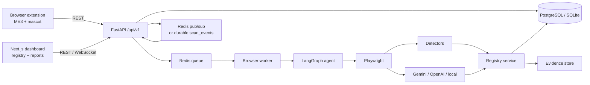

# BugPilot

Agentic UI testing, bug intelligence and browser experience platform.

BugPilot points a Playwright-driven agent at a site you are authorized to test, discovers real UI
defects, verifies them, and turns every sighting into a persistent, evidence-backed record in a
Living Bug Registry. A browser extension gives the same run a face: an animated bug scout that
reacts to real agent events and docks into a completion widget with the findings.

```
Discover · Investigate · Verify · Document · Resolve · Regression-proof
```

## What it actually does

- **Three explicit scan scopes** — full website, current URL, or a single selected element. The
  scope is enforced in the worker and the action policy, not just described to a model.
- **Agent exploration** — a LangGraph workflow observes the page, plans actions, scores them,
  executes them with Playwright, runs detectors, verifies findings and stops on budgets.
- **Deterministic detectors** — layout overlap and clipping, horizontal overflow, broken images,
  console and page errors, failed requests, accessibility basics, form risks, navigation blanks,
  content clipping and unreadable text.
- **AI reasoning layer** — Gemini, OpenAI or a deterministic local fallback. Vision and reasoning
  are optional; the product still works without a provider key.
- **Severity, priority and confidence as separate axes** — with an explainable priority rationale
  that combines severity, evidence strength, critical routes, regressions, reach and workarounds.
- **Living Bug Registry** — canonical issues with per-scan occurrences, evidence, status history,
  manual merge, assignment and notes. Recurring defects update the record instead of duplicating it.
- **Regression detection** — a fixed or closed issue that reappears is reopened and flagged.
- **Fix verification** — replays the recorded reproduction and reports `fixed`, `still_failing` or `inconclusive`, never a false pass.
- **Reports** — Markdown, PDF and a ZIP bundle with the screenshots the report references.
- **Browser extension (Manifest V3)** — scope selector, animated mascot, element picker, live
  findings, draggable completion widget, optional sound. Off by default and fully usable without it.
- **Safety** — signed evidence URLs, redaction, size limits, private-network blocking, destructive
  action policy, form-submission guards, and explicit user consent for scope.

## Architecture



More detail: [docs/architecture.md](docs/architecture.md).

## Repository layout

```
apps/web              Next.js 15 dashboard (App Router, Tailwind, Recharts, Framer Motion)
apps/extension        Manifest V3 extension (mascot, scope selector, widget)
services/api          FastAPI application, routers, serializers
services/browser-worker  Playwright worker and scan loop
packages/core         Agent graph, detectors, AI providers, registry, reporting, evidence
migrations            Alembic migrations
fixtures/broken-shop  Deliberately broken demo shop with real defects
tests                 Unit, integration and API contract tests
scripts               End-to-end smoke scripts and icon generator
```

## Quick start (local)

Requires Python 3.12+, Node 22+.

```bash
python -m venv .venv
source .venv/Scripts/activate          # Windows: .venv\Scripts\activate
pip install -e ".[dev]"
python -m playwright install chromium

cp .env.example .env                   # optional: add an AI key
```

Terminal 1 — demo site:

```bash
cd fixtures/broken-shop
uvicorn server:app --host 127.0.0.1 --port 4173
```

Terminal 2 — API (migrations run on startup):

```bash
uvicorn app.main:app --app-dir services/api --reload
```

Terminal 3 — worker:

```bash
python -m worker.main            # from services/browser-worker, or install the package
```

Terminal 4 — dashboard:

```bash
cd apps/web
npm install
npm run dev
```

Open <http://localhost:3000>, enter `http://127.0.0.1:4173/`, choose **Current URL**, and start a scan.
The scan workspace streams agent events, findings appear as they are verified, and the registry fills
with canonical issues.

### Docker Compose

```bash
export EVIDENCE_SIGNING_SECRET=$(python -c "import secrets;print(secrets.token_hex(32))")
docker compose up --build
```

This starts PostgreSQL, Redis, the API, the worker, the dashboard and the demo shop. See
[docs/deployment.md](docs/deployment.md).

## Scan modes

| Mode | What it inspects | What it refuses to do |
| --- | --- | --- |
| Full website | Same-origin routes inside depth, pattern and page budgets | Leave the origin, exceed depth, follow excluded patterns |
| Current URL | Exactly the URL you selected | Follow links, change route, submit forms |
| Selected element | The chosen element and its subtree | Inspect unrelated regions, navigate away |

Enabling the extension never starts a scan. The scope is persisted on the scan (`scope_json`) and
reported back in the UI and exports. If a click or script navigation leaves the scope, the worker
returns to the authorized page and records why.

## Browser extension

1. Go to `chrome://extensions`, enable Developer mode, choose **Load unpacked**, select
   `apps/extension`.
2. Open the popup, choose **Settings**, confirm the backend URL (`http://localhost:8000`).
3. Pick a scope on the page, press **Start scan**.

Details and limitations: [docs/extension.md](docs/extension.md).

## Bug Registry

Every defect gets one canonical `issues` row keyed by project, category, route, DOM fingerprint and
normalized error signature. Every scan that observes it adds an `issue_occurrences` row with its own
evidence, so history is never overwritten. Lifecycle transitions are validated server-side and
audited in `issue_events`.

Recurring defects increment `occurrence_count`. A defect that reappears after `fixed`, `verified` or
`closed` becomes `reopened` with `is_regression = true`.

More: [docs/registry.md](docs/registry.md) and [docs/verification.md](docs/verification.md).

## API (v1)

| Method | Path | Purpose |
| --- | --- | --- |
| POST | `/api/v1/projects` | Create a project |
| GET | `/api/v1/projects/{id}` | Project health |
| POST | `/api/v1/scans` | Create a scan (idempotency key supported) |
| GET | `/api/v1/scans` | Paginated scan list |
| GET | `/api/v1/scans/{id}` | Scan, pages, actions, budgets, findings and event history |
| POST | `/api/v1/scans/{id}/pause\|resume\|stop` | Scan control |
| WS | `/api/v1/scans/{id}/events` | Live agent events |
| GET | `/api/v1/findings/{id}` | Finding detail with signed evidence URLs |
| GET | `/api/v1/issues` | Registry search, filters, grouping, sorting, pagination |
| GET | `/api/v1/issues/trends` | New / resolved / reopened per day |
| GET | `/api/v1/issues/{id}/duplicates` | Ranked duplicate suggestions |
| POST | `/api/v1/issues/bulk` | Bulk triage with per-issue outcomes |
| POST | `/api/v1/issues/{id}/transition` | Validated lifecycle change |
| POST | `/api/v1/issues/{id}/notes\|assign\|merge` | Triage operations |
| POST | `/api/v1/issues/{id}/verify-fix` | Replay the reproduction and verify a fix |
| GET | `/api/v1/issues/{id}/verifications` | Verification history |
| GET | `/api/v1/reports/scan/{id}.md\|.pdf\|.zip` | Scan report exports |
| GET | `/api/v1/reports/finding/{id}.md` | Single-finding export |
| GET | `/api/v1/reports/project/{id}.md\|.pdf` | Project report |
| GET | `/api/v1/reports/issue/{id}.md` | Registry issue export |
| GET | `/api/v1/dashboard` | Overview aggregates |

Errors use one shape: `{"detail": {"code": "...", "message": "...", "details": ...}}`.

## Tests

```bash
pytest -q                 # 84 tests: unit, integration, API contracts, extension and reporting
ruff check .
cd apps/web && npm run build
```

End-to-end against the demo shop (starts the API, worker and fixture itself):

```bash
python scripts/e2e_smoke.py
python scripts/e2e_single_url.py
python scripts/e2e_registry.py
python scripts/e2e_extension.py
python scripts/e2e_verification.py
```

The registry script proves deduplication across scans, the full lifecycle, invalid-transition
rejection and regression reopening. The extension script loads the unpacked extension in real
Chromium and checks the popup, overlay and element picker. The verification script proves all
three verdicts against the fixture.

## Configuration

All settings are environment variables documented in [.env.example](.env.example). The important
ones:

- `DATABASE_URL` — SQLite locally, PostgreSQL in production.
- `EVIDENCE_SIGNING_SECRET` — required in production; evidence URLs are signed.
- `AI_PROVIDER`, `GEMINI_API_KEY`, `OPENAI_API_KEY` — leave empty for deterministic-only mode.
- `AI_SEND_PAGE_TEXT` — off by default; page text is not sent to providers without consent.
- `BLOCK_PRIVATE_TARGETS`, `ALLOWED_HOST_SUFFIXES` — target allow-listing and SSRF defence.

## Security and honest limitations

BugPilot is designed for sites you own or are explicitly authorized to test. It does not bypass
authentication, CAPTCHAs or access controls, and it never claims full coverage. Root causes are
labelled as hypotheses until confirmed. See [docs/security.md](docs/security.md) and
[docs/limitations.md](docs/limitations.md).

Authentication, multi-tenant access control and GitHub integration are **not** implemented; the
current deployment is single-operator. This is stated here so it is not mistaken for a finished
enterprise product.

## License

No license file has been added yet. Add one before publishing the repository.