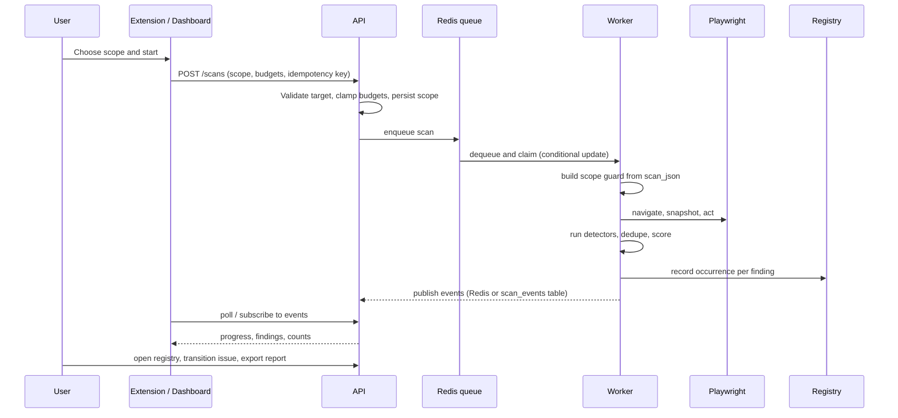
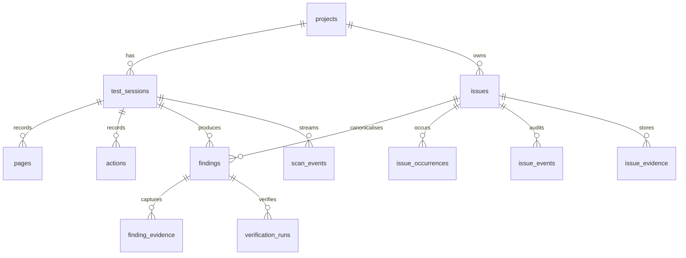

# Architecture

## Request and scan lifecycle



## Modules

| Module | Responsibility |
| --- | --- |
| `bugpilot_core/models.py` | Pydantic contracts: scope, config, findings, events, enums |
| `bugpilot_core/scope.py` | Hard scope enforcement: navigation, actions, depth, patterns |
| `bugpilot_core/agent/graph.py` | LangGraph workflow and node implementations |
| `bugpilot_core/agent/browser.py` | Playwright session, DOM snapshot, screenshots, console/network capture |
| `bugpilot_core/detectors/` | Deterministic checks; no AI required |
| `bugpilot_core/ai/` | Provider interface, Gemini, OpenAI, deterministic local fallback |
| `bugpilot_core/dedupe.py` | Semantic overlap within a scan |
| `bugpilot_core/severity.py` | Severity scoring and explainable priority scoring |
| `bugpilot_core/registry.py` | Canonical issues, occurrences, lifecycle, merge, regression |
| `bugpilot_core/evidence.py` | Storage adapter, redaction, signed URLs, retention |
| `bugpilot_core/reporting.py` | Markdown, PDF and ZIP exports |
| `bugpilot_core/events.py` | Redis pub/sub with durable database fallback |

## The agent graph

```
START → initialize → analyze_page → discover_elements → run_detectors
      → analyze_suspicious (only if signals) → collect_evidence
      → verify_findings → update_state
            ├─ plan_action → execute_action → observe → run_detectors (loop)
            └─ generate_report → END
```

Budgets are checked in `update_state`: duration, pages, actions, model calls, and "no new states".
Pause and stop are read from the database on every action, so they work while the agent is running,
even from another process.

Verification re-snapshots the page and re-runs the detectors. This is honest but limited: it proves
the signal still exists at that moment, not that a specific user flow reproduces it. The UI and
reports label confidence accordingly.

## Scope enforcement

`ScanScope` is stored in `test_sessions.scope_json` and reconstructed into a `ScopeGuard` by the
worker. Every planned action is checked twice: when planning and immediately before execution.
Navigation is re-validated after a click, because form submits and scripts can navigate without an
`href`. Anything that escapes the scope is rolled back and recorded in `actions.block_reason` and
`test_sessions.pages_skipped`.

## Data model



Migrations live in `migrations/` and are applied on startup by `init_db()`. Create a new revision
with:

```bash
alembic revision --autogenerate -m "describe the change"
alembic upgrade head
```

## Event transport

- With Redis: events are published to `bugpilot:scan:<id>` and appended to a capped list.
- Without Redis: events are stored in `scan_events`, and the WebSocket polls durable history. This
  keeps the API and worker consistent locally without hiding the missing dependency.

`GET /api/v1/health` reports which transport is active.

## AI usage

AI is used for visual anomaly hypotheses and reasoning (expected vs observed, root cause, suggested
fix, reproduction steps). Deterministic tools own browser actions, scope and verification. Model
calls are capped per scan and logged in `model_runs` with latency and provider.